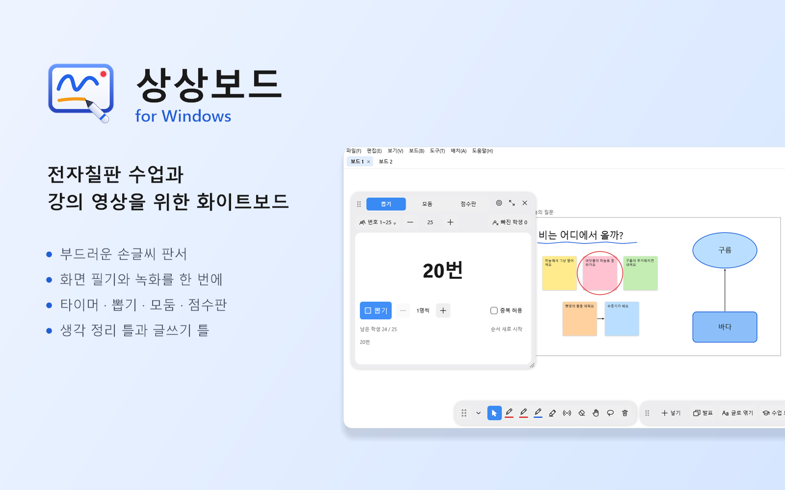
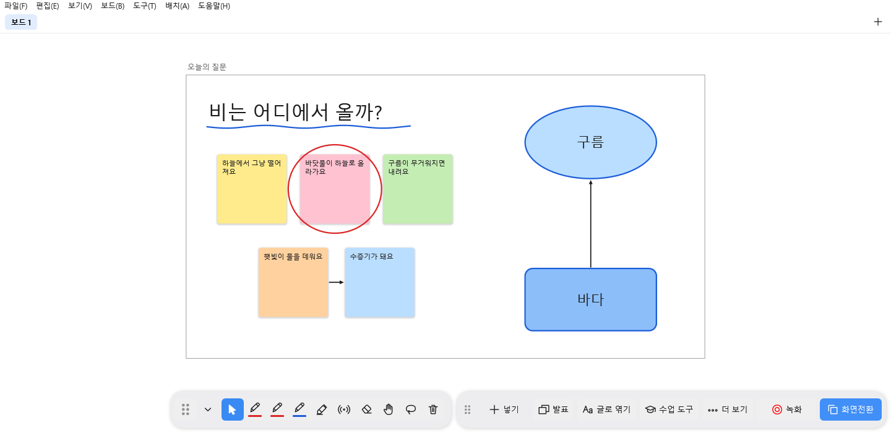
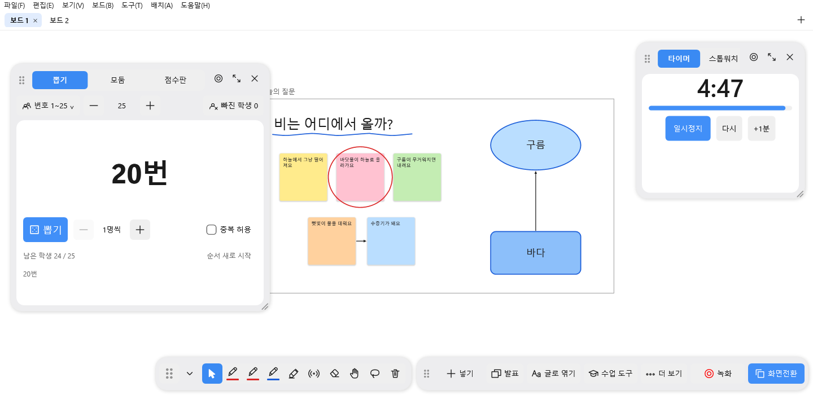
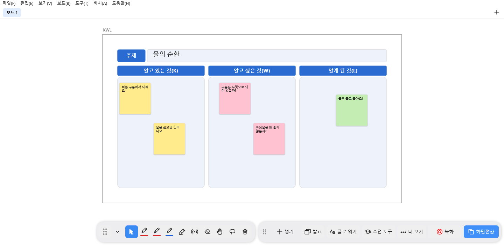
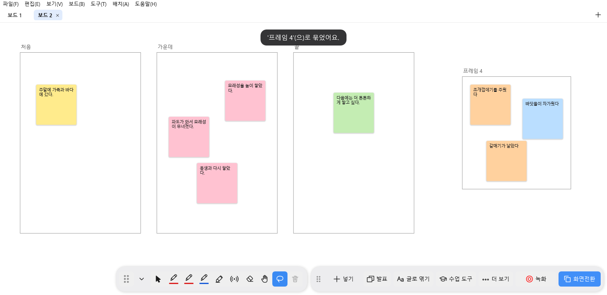
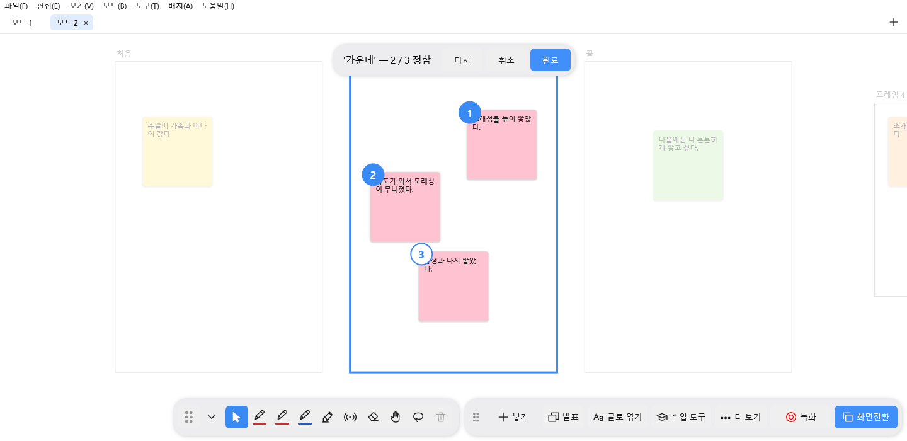
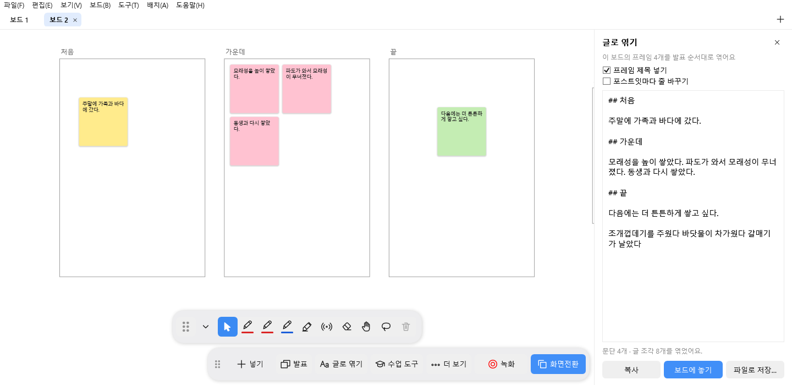

<h1 align="center">상상보드 for Windows</h1>

전자칠판 수업과 강의 영상을 위한 화이트보드

  <a href="https://github.com/astheboy/SangSangBoard_Win/releases/latest"><b>⬇ 최신 버전 내려받기</b></a>

## 이런 앱이에요

- **부드러운 손글씨 판서**: 전자칠판 손가락·펜 입력에 맞춘 필기, 두 손가락으로 이동·확대
- **화면 필기와 녹화**: 화이트보드와 다른 프로그램 화면 위 필기를 오가며 한 영상으로 녹화
- **수업 도구**: 타이머·스톱워치, 이름 뽑기, 모둠 만들기, 점수판. 창 모서리를 끌어 크기를 바꿀 수 있어요
- **생각 정리 틀·글쓰기 틀**: KWL 같은 틀을 넣고, 포스트잇을 둘러 묶어 프레임으로 만들고, 순서를 정해 글로 엮기
- **포스트잇·도형·연결선·이미지·PDF·YouTube**를 한 보드에, 프레임별 발표와 PDF·PowerPoint 내보내기

## 화면

| | |
|---|---|
|  |  |
| 포스트잇·도형·연결선과 판서 | 타이머와 이름 뽑기 |
|  |  |
| 생각 정리 틀(KWL) | 흩어진 생각을 둘러 묶어 프레임으로 |
|  |  |
| 눌러서 순서 정하기 | 프레임 순서대로 글로 엮기 |

## 설치

1. [Releases](https://github.com/astheboy/SangSangBoard_Win/releases/latest)에서 `SangSangBoard-Setup-v….exe`를 내려받아 실행합니다.
2. 처음 실행할 때 **"Windows의 PC 보호"** 창이 뜨면 **추가 정보 → 실행**을 누르세요(코드 서명이 아직 없습니다).
3. 설치한 뒤에는 앱을 켤 때 새 버전이 있으면 업데이트를 묻습니다.

- 요구 사항: **Windows 11** (64비트)
- 관리자 권한 없이 사용자 계정에 설치됩니다.
- 맥용 상상보드와 같은 `.board` 파일을 주고받을 수 있어요.

## 문의

버그나 제안은 [Issues](https://github.com/astheboy/SangSangBoard_Win/issues)에 남겨 주세요.

이 저장소는 설치 파일 배포용이며 소스 코드는 들어 있지 않습니다.
